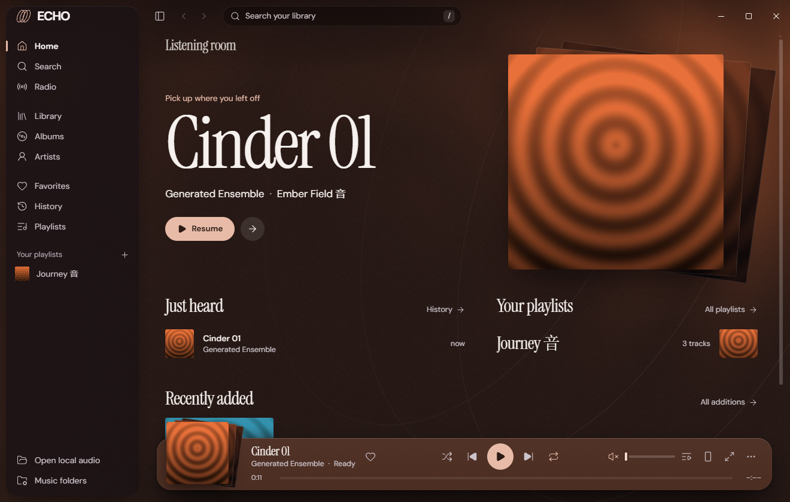
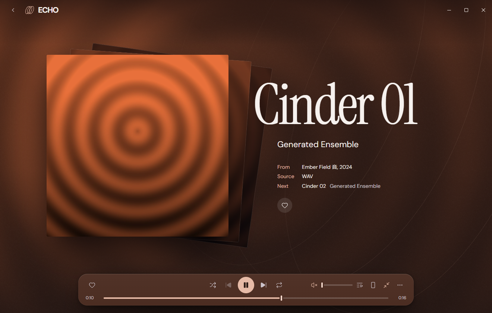
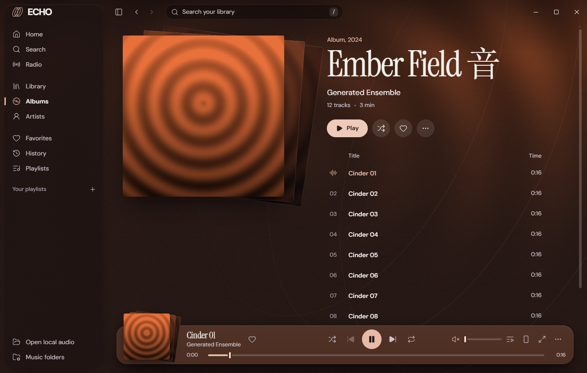
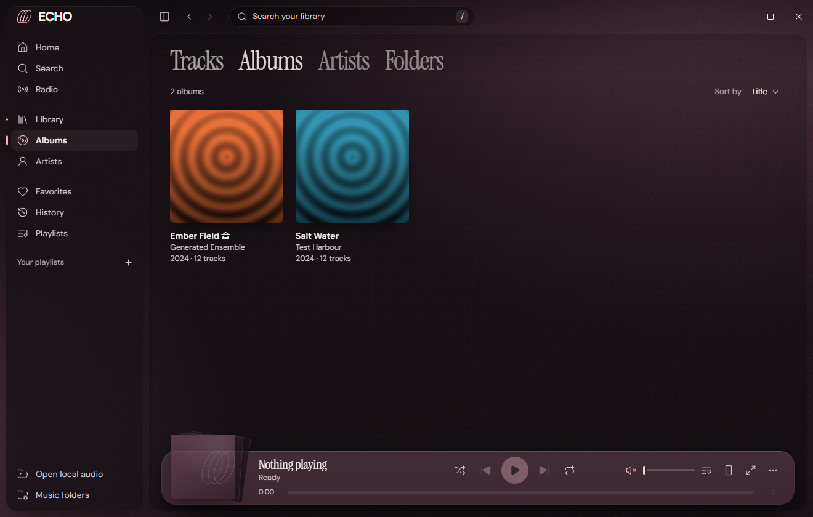
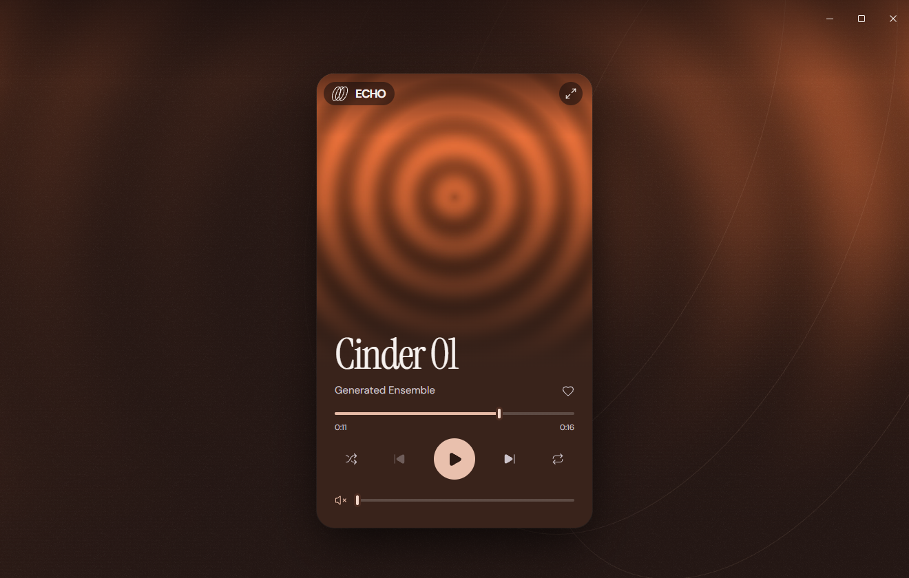

<div align="center">

# ECHO

**A local-first music and internet radio player for Windows.**

[Website](https://echo.wiktorfila.dev) · [Download](https://github.com/Venuss1337/echo/releases) · [Documentation](docs/README.md) · [Contributing](CONTRIBUTING.md)



</div>

ECHO plays the music on your own drives and direct internet radio streams in
an interface built around album art. Your library, playlists and listening
history stay on your computer: there is no account, no subscription, no
telemetry and no cloud service behind it.

## Features

- **Your library.** Add music folders and ECHO indexes them in the
  background, keeps up with changes, and browses by album, artist and track
  with instant search. Large libraries stay responsive.
- **Formats.** MP3, FLAC, WAV, Ogg Vorbis and AAC/M4A, played by libmpv and
  FFmpeg built from source.
- **Playlists, favorites and history** that survive moved files, missing
  drives and removed folders.
- **Internet radio.** Search the [Radio Browser](https://www.radio-browser.info/)
  directory or add a station by URL, with favorites and recent stations.
  Direct MP3 and AAC streams over HTTP and HTTPS.
- **Now Playing** that takes its light from the cover, a compact edition and
  an always-on-top mini player.
- **Windows integration.** Media keys and the Windows media flyout, a tray
  menu for background playback, Snap Layouts, and a single running instance.
- **Accessible.** Full keyboard operation, visible focus, screen-reader
  labels, artwork-aware contrast checks, and reduced motion.

<table>
  <tr>
    <td></td>
    <td></td>
  </tr>
  <tr>
    <td></td>
    <td></td>
  </tr>
</table>

*Screenshots show the real application with a generated demonstration
library; the album art is drawn by a script in this repository.*

## Install

ECHO is available as source. Check Releases for Windows installers and their checksums.

ECHO runs on **Windows 10 and 11, x64**. It needs the Microsoft Edge WebView2
runtime, which current Windows includes; the installer fetches it from
Microsoft if it is missing.

1. Download `ECHO-<version>-windows-x64-setup.exe` from
   [Releases](https://github.com/Venuss1337/echo/releases).
2. Optionally verify it against `SHA256SUMS.txt` or with
   `gh attestation verify <file> --repo Venuss1337/echo`.
3. Run it. ECHO installs for the current user and does not need
   administrator rights.

The installer is not code-signed, so Windows SmartScreen may warn about an
unrecognized app; choose **More info → Run anyway** after verifying the
download.

## Use

- **Add music:** *Music folders* in the sidebar, then choose a folder. ECHO
  only ever reads your files.
- **Play:** double-click a track, or use the play buttons on albums, artists
  and playlists. `Space` plays and pauses; the dock holds every control.
- **Radio:** open *Radio*, search the directory or add a station URL.
- **Background playback:** *Hide to tray* from the tray icon; use the tray or
  your media keys to control playback.

## Build from source

Requirements: Windows 10/11 x64, PowerShell 7, Rust via rustup (the
toolchain is pinned), Microsoft C++ Build Tools with a Windows SDK, Bun 1.4.5
and Node.js 22.

```powershell
git clone https://github.com/Venuss1337/echo.git
cd echo
bun install --frozen-lockfile
bunx playwright install chromium
bun run verify        # lint, types, contracts, Rust and browser tests
bun run tauri dev     # run the app (audio needs the decoder, see below)
```

Playback uses a libmpv build that ECHO compiles from pinned sources; see
[Native decoder](docs/NATIVE.md) for building it and running the app with
audio, and [Development](docs/DEVELOPMENT.md) for everything else.

## How it is built

A Tauri 2 shell with a Rust host that owns playback, the SQLite library,
radio networking and Windows integration, and a React renderer that only
presents confirmed state over typed, generated IPC contracts.

| | |
| --- | --- |
| [Architecture](docs/ARCHITECTURE.md) | Processes, ownership and source layout |
| [Playback](docs/PLAYBACK.md) | The playback worker and the decoder boundary |
| [Library](docs/LIBRARY.md) | SQLite, scanning and durable user data |
| [Radio](docs/RADIO.md) | Directory and the pinned HTTPS connector |
| [Windows](docs/WINDOWS.md) | Window, mini player, tray, media controls |
| [Design](docs/DESIGN.md) | The Atmosphere 2.0 interface |
| [Security](docs/SECURITY.md) | Trust boundaries and threat model |
| [Testing](docs/TESTING.md) | Every suite and the manual checklist |

## Contributing

Bug reports, fixes, tests and documentation are welcome, including
AI-assisted contributions held to the same standard. Start with
[CONTRIBUTING.md](CONTRIBUTING.md). Report security issues privately as
described in [SECURITY.md](SECURITY.md).

## License

ECHO is free software under the [GNU General Public License v3.0 or
later](LICENSE). It includes libmpv, FFmpeg and other components under their
own licenses; each release publishes the complete corresponding source and
notices. See [Licensing](docs/LICENSING.md).
